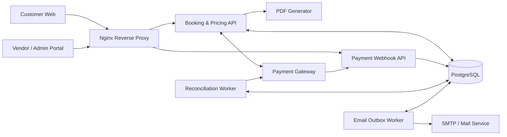
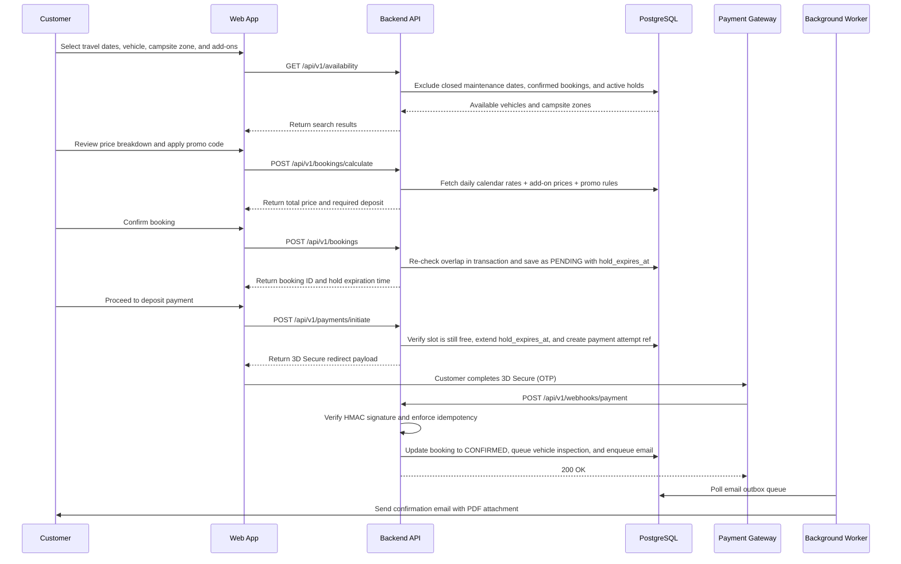
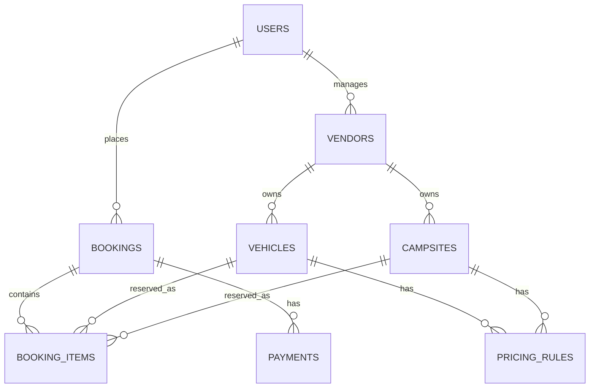

[ไทย](README.md) | [English](README.en.md)

# Campervan & Campsite Booking Platform Architecture

> **Portfolio & NDA Notice:** This repository contains generalized system architecture, workflow diagrams, and sanitized API/data specifications created strictly for technical portfolio purposes. All proprietary source code, database table names, production endpoints, credentials, and company/provider identifiers have been omitted or replaced with generic mock data in strict compliance with Non-Disclosure Agreements (NDA).

A multi-vendor booking platform for campervans (RVs) and campsites. Customers can plan a road trip and book vehicles, campsite zones, and add-on equipment in a single reservation, complete with pre-trip mechanic inspection workflows and online deposit payments.

Stack: React, .NET Web API, PostgreSQL, WebSocket, Nginx, Linux Cloud VPS, GitLab CI/CD

## Role: Systems Analyst

- Analyzed business requirements and designed end-to-end multi-vendor booking workflows for campervans and campsites
- Designed the relational database schema (ERD), temporary availability hold logic, and seasonal/add-on pricing rules
- Wrote the RESTful API specifications (OpenAPI/Swagger) for the frontend and backend teams
- Set up and maintained infrastructure on a Linux Cloud VPS, including Nginx reverse proxy, SSL/TLS, automated database backups, and GitLab CI/CD
- Conducted system integration and user acceptance testing (SIT / UAT) for the deposit payment workflow and vehicle handover/return inspection documents


## Problem & Solution

Booking campervans alongside campsites is more involved than a standard hotel reservation because a customer can book a vehicle only, a campsite only, or bundle a vehicle with multiple campsite stops across a single trip.

Key challenges addressed in the design:

- **Date-range overlap across different inventory types:** Each campervan is a single physical unit (1 unit per license plate, subject to maintenance blackout dates), whereas campsites are divided into zones measured by available slots per night. The system checks each resource type with its own rule inside a single database transaction when creating a booking.
- **Pickup/drop-off hubs and mechanic inspections:** Vehicles can be picked up and returned at designated hubs. Once a booking with a vehicle is confirmed, it enters a mechanic inspection queue for pre-trip preparation and generates A4 handover/return inspection checklists.
- **Multi-rule pricing calculation:** Both vehicles and campsite zones have base rates and daily calendar overrides (weekends/holidays). Campsite zones can charge per night or per person, alongside optional equipment add-ons and category-scoped promo codes.
- **Deposit payments and abandoned cart locks:** Deducting inventory permanently before payment lets abandoned carts lock up vehicles, while not locking at all leads to double bookings when two customers pay at the same time. We solved this with a time-limited temporary hold (`hold_expires_at`) that is verified before redirecting to the payment gateway and re-verified when the payment webhook arrives.


## System Architecture & Data Flow

The platform operates across three main parts:

1. **Customer & Partner Web Apps:** Customers search availability and book trips on the web app, while campsite partners, admins, and mechanics manage inventory, daily pricing calendars, and vehicle inspection forms in the back-office portal.
2. **Booking & Payment API:** The backend handles overlap checks, server-side price calculations, temporary slot holds, and payment webhook processing.
3. **Background Workers:** Scheduled background jobs reconcile pending payments with the payment gateway and dispatch transactional emails with PDF booking confirmations.



### Booking & Deposit Payment Sequence




## Simplified ERD (Key Entities)



| Entity | Purpose |
| --- | --- |
| `users` | Platform users, separated by role (Customer, Vendor/Partner, Admin, Mechanic) |
| `vendors` | Partner businesses that own and manage campervans or campsites |
| `vehicles` | Individual campervan units, specs, base rates, pickup hubs, and current status (available, booked, maintenance) |
| `campsites` | Campsite properties and zones, nightly slot capacity, and fee calculation type (per night vs. per person) |
| `pricing_rules` | Daily calendar overrides for seasonal/holiday pricing and maintenance blackout dates |
| `bookings` | Master booking record storing travel dates, totals, discount, status, and temporary lock expiry (`hold_expires_at`) |
| `booking_items` | Line items linking a booking to specific vehicles (with pickup/drop-off points), campsite zones, and equipment add-ons |
| `payments` | Deposit and balance payment records, tracking individual payment attempt references and webhook verification results |


## Core API & Sample Payloads (Dummy Data)

Paths and payloads below are illustrative mock examples, not the production system's actual endpoints.

| Method | Path | Purpose |
| --- | --- | --- |
| GET | `/api/v1/availability` | Search available campervans and campsite zones for a date range |
| POST | `/api/v1/bookings/calculate` | Calculate seasonal daily rates, add-ons, discounts, and deposit amount |
| POST | `/api/v1/bookings` | Create a booking and acquire a temporary slot hold |
| POST | `/api/v1/payments/initiate` | Start a deposit payment attempt and refresh the hold timer |
| POST | `/api/v1/webhooks/payment` | Receive payment gateway callbacks with HMAC signature verification |

Search available vehicles and campsites

```http
GET /api/v1/availability?start_date=2026-12-05&end_date=2026-12-08&guests=4&province=CNX
```

```json
{
  "vehicles": [
    {
      "id": "VEH-01",
      "name": "Campervan Type A (4 Seats)",
      "base_rate": 4500,
      "period_total": 14500,
      "pickup_points": ["CNX-AIRPORT", "CNX-DOWNTOWN"]
    }
  ],
  "campsites": [
    {
      "id": "CAMP-12",
      "zone_id": "ZONE-A",
      "name": "Valley RV Zone A",
      "fee_type": "PER_NIGHT",
      "rate": 800,
      "available_slots": 3
    }
  ]
}
```

Calculate total price and deposit

```json
POST /api/v1/bookings/calculate
{
  "vehicle_id": "VEH-01",
  "pickup_point": "CNX-AIRPORT",
  "dropoff_point": "CNX-AIRPORT",
  "campsite_zone_id": "ZONE-A",
  "start_date": "2026-12-05",
  "end_date": "2026-12-08",
  "guests": 4,
  "addons": [{ "code": "BBQ-SET", "qty": 1 }],
  "promo_code": "WINTER10"
}
```

```json
{
  "subtotal": 16600,
  "discount": 1660,
  "net_total": 14940,
  "deposit_required": 7470,
  "balance_on_pickup": 7470
}
```

Create booking with temporary hold

```json
POST /api/v1/bookings
{
  "user_id": "USR-104",
  "vehicle_id": "VEH-01",
  "campsite_zone_id": "ZONE-A",
  "start_date": "2026-12-05",
  "end_date": "2026-12-08",
  "guests": 4,
  "promo_code": "WINTER10"
}
```

```json
{
  "booking_id": "BKG-20261205-001",
  "status": "PENDING_HOLD",
  "hold_expires_at": "2026-11-13T07:25:00Z"
}
```

Payment gateway webhook callback (signed with HMAC)

```json
POST /api/v1/webhooks/payment
{
  "order_ref": "BKG-20261205-001-01",
  "transaction_ref": "TXN-990124",
  "amount": "7470.00",
  "currency": "THB",
  "status": "SUCCESS",
  "masked_pan": "411111******1111",
  "signature": "8f4b2e19c7a0..."
}
```


## Deployment, Infrastructure & Lessons Learned

### Lessons Learned

**Preventing double bookings and race conditions**
Initially, availability queries only excluded bookings that were already paid. If two customers selected the same campervan for overlapping dates and went to the payment page at the same time, both payments could go through. We solved this by setting a 25-minute temporary hold (`hold_expires_at`) when the booking is created and checking availability at three points: on booking creation, right before redirecting to the bank (where the hold timer is also refreshed so slow OTP entry doesn't time out mid-payment), and when the payment webhook settles. If a hold expires during a delayed payment and someone else takes the slot in the meantime, the system prevents double confirmation and flags the booking for an admin refund.

**Separate payment attempts from booking status**
Customers often fail their first payment attempt due to card limits or mistyped OTPs. If a failed attempt immediately cancels the booking, the customer has to re-select dates and fill out the form all over again. We separated individual payment attempts (`BKG-001-01`, `BKG-001-02`) from the booking itself: a declined card only closes that attempt while keeping the booking open for retry as long as the hold timer hasn't expired.

**Never trust prices or statuses sent from the client**
To prevent payload tampering, daily rates, promotional discounts, and the initial pending status are always calculated and enforced on the backend. The frontend only submits resource IDs, travel dates, guest counts, and promo codes.

**Payment webhooks can arrive late or drop**
Sometimes a customer completes bank payment, but a network hiccup drops the webhook callback. A background reconciliation job periodically checks pending payment attempts directly against the payment gateway API, using PostgreSQL advisory locks so multiple application instances never run the same sweep concurrently.

**Keep campsite-only bookings out of the mechanic queue**
Bookings with a campervan must go through a mechanic inspection checklist before handover. Campsite-only bookings have no vehicle to inspect, so the backend classifies the booking type upon confirmation and routes campsite-only reservations straight to check-in readiness instead of leaving them stuck waiting for a mechanic.

### Infrastructure & Operations

The platform runs on a **Linux Cloud VPS**, with Staging and Production separated into isolated environments.

**Nginx Reverse Proxy & SSL/TLS**
- Only HTTP (for HTTPS redirection) and HTTPS (443) are exposed externally.
- Nginx serves as the single entry point, handling TLS 1.2 / 1.3 termination, proxying `/api` traffic to the local backend service, upgrading WebSocket connections, and enforcing upload size limits for vehicle inspection photos.
- SSL certificates renew automatically, running `nginx -t` to validate configuration syntax before reloading so live traffic is never interrupted.

**GitLab CI/CD & Source Control**
- Work is split across `main` (Production), `develop` (Staging), and `feature/*` branches, with all changes merged via Merge Requests.
- Secrets (database connection strings, JWT keys, payment gateway secrets) are stored in server environment variables and GitLab CI/CD variables—never inside the repository.
- Database schema changes are written as idempotent SQL scripts and verified on Staging prior to production deployment.

**Automated Database Backup & Log Retention**
- A daily cron job on the Linux Cloud VPS runs compressed `pg_dump` backups for PostgreSQL and rotates old backup files according to the retention policy.
- Payment logs automatically strip credentials and mask credit card numbers before being written to the database, preserving a safe audit trail for troubleshooting and financial reconciliation.
