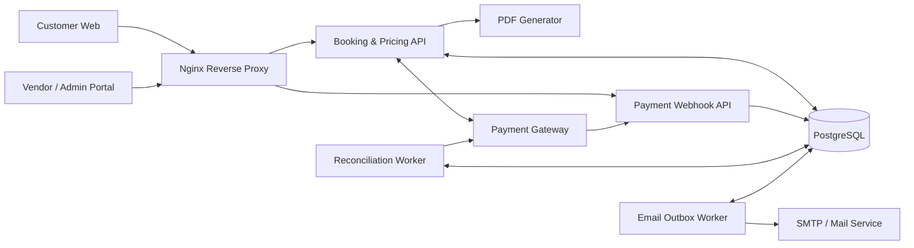
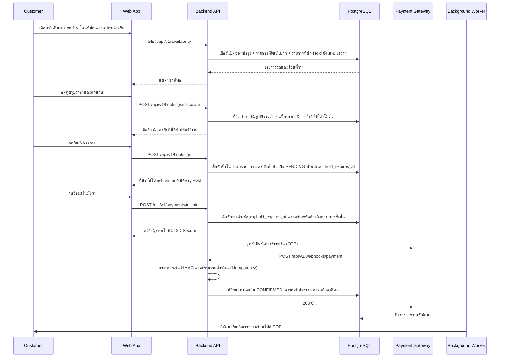
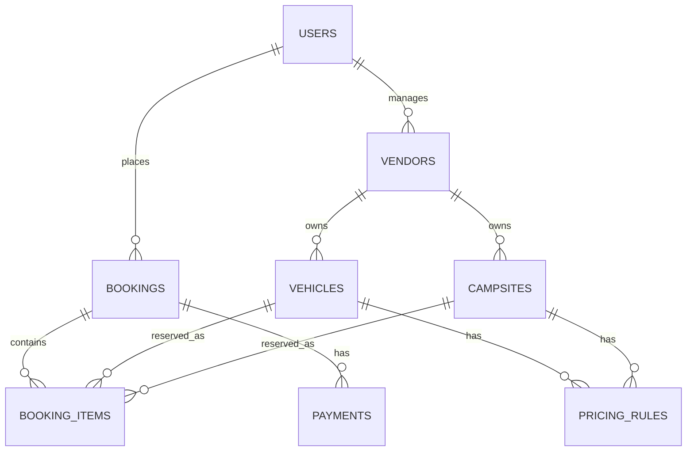

[ไทย](README.md) | [English](README.en.md)

# Campervan & Campsite Booking Platform Architecture

> **หมายเหตุเรื่องความลับทางการค้า (NDA Notice):** เอกสารใน Repository นี้จัดทำขึ้นเพื่อแสดงแนวคิดการวิเคราะห์ระบบ การออกแบบสถาปัตยกรรม และ Workflow สำหรับประกอบการสมัครงานเท่านั้น ซอร์สโค้ดจริง โครงสร้างตารางจริง Endpoint ของระบบ Production ข้อมูลรับรอง (Credentials) รวมถึงชื่อองค์กรและผู้ให้บริการทั้งหมดถูกตัดออกหรือแทนที่ด้วยข้อมูลสมมติเพื่อปฏิบัติตามข้อตกลงรักษาความลับ (NDA) อย่างเคร่งครัด

ระบบจองรถบ้าน (Campervan / RV) และลานกางเต็นท์แบบ Multi-Vendor ให้ลูกค้าวางแผนทริปและจองทั้งรถบ้าน ที่พัก และอุปกรณ์เสริมได้ในใบจองเดียว พร้อมระบบจัดการคิวตรวจสภาพรถก่อนส่งมอบ และระบบรับชำระเงินมัดจำออนไลน์

Stack: React, .NET Web API, PostgreSQL, WebSocket, Nginx, Linux Cloud VPS, GitLab CI/CD

## หน้าที่ที่รับผิดชอบ (Role: Systems Analyst)

- วิเคราะห์ Business Requirement และออกแบบ Workflow การจองรถบ้านและลานกางเต็นท์แบบ Multi-Vendor
- ออกแบบโครงสร้างฐานข้อมูลเชิงสัมพันธ์ (ERD), เงื่อนไขการเช็กคิวรถว่าง (Availability Lock) และการคำนวณราคาตามฤดูกาล/แพ็กเกจเสริม
- จัดทำ RESTful API Specification (OpenAPI/Swagger) สำหรับทีม Frontend และ Backend
- ดูแลโครงสร้าง Infrastructure บน Linux Cloud VPS, Nginx Reverse Proxy, SSL/TLS, Automated DB Backup และ GitLab CI/CD
- ทดสอบระบบและตรวจสอบความถูกต้องของ Workflow การชำระเงินมัดจำและเอกสารรับ-คืนรถ (SIT / UAT)


## ภาพรวมปัญหาและโซลูชัน (Problem & Solution)

การจองรถบ้านพร้อมลานกางเต็นท์มีเงื่อนไขต่างจากการจองโรงแรมทั่วไป เพราะลูกค้าหนึ่งคนสามารถจองเฉพาะรถบ้าน จองเฉพาะลานกางเต็นท์ หรือจองควบทั้งรถและที่พักหลายจุดในทริปเดียวกันได้

โจทย์หลักที่ต้องแก้ตอนออกแบบระบบ

- **การเช็กช่วงวันทับซ้อนของทรัพยากรคนละแบบ:** รถบ้านนับสต็อกเป็นรายคัน (1 คันรับได้ 1 ทริปในช่วงเวลาเดียวกัน และมีวันปิดซ่อมบำรุง) ส่วนลานกางเต็นท์แบ่งเป็นโซนและนับความจุเป็นจำนวนแปลงต่อคืน ระบบจึงต้องแยกวิธีเช็กคิวว่างตามประเภท แต่รันภายใต้ Transaction เดียวกันตอนกดจอง
- **จุดรับ-ส่งรถ และคิวตรวจสภาพรถ:** รถแต่ละคันกำหนดจุดรับและจุดคืนรถได้หลายสาขา เมื่อจองสำเร็จต้องส่งงานต่อให้ทีมช่างตรวจเช็กสภาพรถตาม Checklist ก่อนวันรับรถ และมีใบตรวจสภาพตอนรับ-คืนรถ
- **การคำนวณราคาหลายเงื่อนไข:** ทั้งรถบ้านและโซนลานกางเต็นท์มีราคาฐานและราคาพิเศษตามปฏิทิน (วันหยุด/เทศกาล) ค่าลานกางเต็นท์บางโซนคิดรายคืน บางโซนคิดรายคน บวกกับมีแพ็กเกจอุปกรณ์เสริมและโค้ดส่วนลดที่จำกัดเฉพาะหมวดหมู่ได้
- **การแบ่งจ่ายมัดจำและปัญหาคิวค้างตอนรอจ่ายเงิน:** ถ้าตัดคิวรถทันทีที่กดจองโดยไม่มีเวลาหมดอายุ รถจะค้างเมื่อลูกค้าปิดหน้าเว็บหนี แต่ถ้าไม่ล็อกคิวเลย ลูกค้าสองคนจะกดจ่ายเงินรถคันเดียวกันชนกันได้ จึงออกแบบระบบล็อกคิวชั่วคราว (Temporary Hold) ที่มีเวลาหมดอายุ และตรวจสอบซ้ำทุกครั้งก่อนเข้าหน้าชำระเงินและตอนรับ Webhook จากระบบชำระเงิน


## สถาปัตยกรรมระบบและการไหลของข้อมูล (System Architecture & Data Flow)

ระบบแบ่งการทำงานเป็น 3 ส่วนหลัก

1. **ฝั่งหน้าบ้านและพาร์ทเนอร์:** ลูกค้าค้นหาและจองทริปผ่านเว็บแอป ส่วนพาร์ทเนอร์เจ้าของลานกางเต็นท์และทีมแอดมิน/ช่างจัดการสต็อก ปฏิทินราคา และใบตรวจสภาพรถผ่านระบบหลังบ้าน
2. **ฝั่งประมวลผลคำสั่งจองและการชำระเงิน:** Backend ดูแลการเช็กคิวว่าง คำนวณราคา ล็อกคิวชั่วคราว และรับผลชำระเงินผ่าน Webhook
3. **ฝั่งงานเบื้องหลัง (Background Jobs):** มี Worker คอยตามเช็กสถานะรายการจ่ายเงินที่ค้างอยู่กับ Payment Gateway และคิวส่งอีเมลพร้อมไฟล์ PDF ใบยืนยันการจอง



### ลำดับการจองและการชำระเงินมัดจำ




## โครงสร้างฐานข้อมูลหลัก (Simplified ERD)



| ตาราง (Entity) | หน้าที่ |
| --- | --- |
| `users` | ข้อมูลผู้ใช้งานระบบ แยกสิทธิ์เป็นลูกค้า พาร์ทเนอร์ แอดมิน และช่างตรวจสภาพรถ |
| `vendors` | ข้อมูลผู้ประกอบการหรือพาร์ทเนอร์ที่เป็นเจ้าของรถบ้านและลานกางเต็นท์ |
| `vehicles` | ข้อมูลรถบ้านแต่ละคัน สเปกรถ ราคาฐาน จุดรับ-ส่ง และสถานะปัจจุบัน (ว่าง, จองแล้ว, ซ่อมบำรุง) |
| `campsites` | ข้อมูลลานกางเต็นท์และโซนที่พัก จำนวนแปลงที่รับได้ต่อคืน และรูปแบบการคิดค่าบริการ (รายคืน / รายคน) |
| `pricing_rules` | ปฏิทินกำหนดราคาพิเศษรายวัน (วันหยุด/เทศกาล) และกำหนดวันปิดรับจองของรถหรือโซนที่พัก |
| `bookings` | ใบจองหลัก เก็บช่วงวันเดินทาง ยอดรวม ส่วนลด สถานะใบจอง และเวลาหมดอายุการล็อกคิว (`hold_expires_at`) |
| `booking_items` | รายการย่อยในใบจอง เก็บรายละเอียดรถบ้าน (จุดรับ-ส่งรถ) โซนลานกางเต็นท์ และแพ็กเกจอุปกรณ์เสริมที่เลือก |
| `payments` | ประวัติการชำระเงินมัดจำและยอดคงเหลือ เก็บรหัสอ้างอิงแต่ละครั้งที่กดจ่าย สถานะ และผลการตรวจสอบจาก Webhook |


## ตัวอย่าง Core API & Payload (Dummy Data)

Path และข้อมูลด้านล่างเป็นตัวอย่างสมมติ ไม่ใช่ Endpoint และข้อมูลจริงของระบบ

| Method | Path | ใช้ทำอะไร |
| --- | --- | --- |
| GET | `/api/v1/availability` | ค้นหารถบ้านและโซนลานกางเต็นท์ที่ว่างตามช่วงวันที่เลือก |
| POST | `/api/v1/bookings/calculate` | คำนวณราคาตามปฏิทินฤดูกาล อุปกรณ์เสริม ส่วนลด และยอดมัดจำ |
| POST | `/api/v1/bookings` | สร้างใบจองและล็อกคิวชั่วคราว (Hold) |
| POST | `/api/v1/payments/initiate` | เริ่มรายการชำระเงินมัดจำและต่อเวลา Hold |
| POST | `/api/v1/webhooks/payment` | รับผลชำระเงินจาก Payment Gateway พร้อมตรวจลายเซ็น |

ค้นหารถบ้านและลานกางเต็นท์ที่ว่าง

```http
GET /api/v1/availability?start_date=2026-12-05&end_date=2026-12-08&guests=4&province=CNX
```

```json
{
  "vehicles": [
    {
      "id": "VEH-01",
      "name": "Campervan Type A (4 Seats)",
      "base_rate": 4500,
      "period_total": 14500,
      "pickup_points": ["CNX-AIRPORT", "CNX-DOWNTOWN"]
    }
  ],
  "campsites": [
    {
      "id": "CAMP-12",
      "zone_id": "ZONE-A",
      "name": "Valley RV Zone A",
      "fee_type": "PER_NIGHT",
      "rate": 800,
      "available_slots": 3
    }
  ]
}
```

คำนวณราคารวมและเงินมัดจำ

```json
POST /api/v1/bookings/calculate
{
  "vehicle_id": "VEH-01",
  "pickup_point": "CNX-AIRPORT",
  "dropoff_point": "CNX-AIRPORT",
  "campsite_zone_id": "ZONE-A",
  "start_date": "2026-12-05",
  "end_date": "2026-12-08",
  "guests": 4,
  "addons": [{ "code": "BBQ-SET", "qty": 1 }],
  "promo_code": "WINTER10"
}
```

```json
{
  "subtotal": 16600,
  "discount": 1660,
  "net_total": 14940,
  "deposit_required": 7470,
  "balance_on_pickup": 7470
}
```

สร้างใบจองและล็อกคิวชั่วคราว

```json
POST /api/v1/bookings
{
  "user_id": "USR-104",
  "vehicle_id": "VEH-01",
  "campsite_zone_id": "ZONE-A",
  "start_date": "2026-12-05",
  "end_date": "2026-12-08",
  "guests": 4,
  "promo_code": "WINTER10"
}
```

```json
{
  "booking_id": "BKG-20261205-001",
  "status": "PENDING_HOLD",
  "hold_expires_at": "2026-11-13T07:25:00Z"
}
```

Webhook แจ้งผลการชำระเงินมัดจำ (แนบลายเซ็น HMAC)

```json
POST /api/v1/webhooks/payment
{
  "order_ref": "BKG-20261205-001-01",
  "transaction_ref": "TXN-990124",
  "amount": "7470.00",
  "currency": "THB",
  "status": "SUCCESS",
  "masked_pan": "411111******1111",
  "signature": "8f4b2e19c7a0..."
}
```


## Deployment, Infrastructure & Lessons Learned

### เรื่องที่ได้เรียนรู้ระหว่างทำ (Lessons Learned)

**การป้องกันการจองซ้อน (Double Booking / Race Condition)**
ตอนแรกการเช็กคิวว่างดูแค่รายการที่จ่ายเงินสำเร็จแล้ว ทำให้ถ้ามีลูกค้าสองคนเลือกวันเดียวกันและกดเข้าหน้าจ่ายเงินพร้อมกัน ทั้งคู่จะจ่ายเงินผ่านทั้งคู่ เลยแก้ด้วยการใส่เวลาล็อกคิวชั่วคราว (`hold_expires_at` 25 นาที) ตั้งแต่วินาทีที่สร้างใบจอง และเช็กซ้ำ 3 จุด คือ ตอนสร้างใบจอง ตอนกดปุ่มไปหน้าธนาคาร (พร้อมต่อเวลา Hold ให้อีกหนึ่งรอบเผื่อรอ OTP นาน) และตอนที่ Webhook แจ้งตัดเงินสำเร็จ ถ้าเกิดกรณีสุดวิสัยที่ Hold หมดเวลาระหว่างรอ OTP แล้วมีคนอื่นจองตัดหน้าไปแล้ว ระบบจะไม่ยืนยันซ้ำ แต่จะเปลี่ยนสถานะใบจองให้แอดมินทำเรื่องคืนเงินแทน

**แยก "การกดจ่ายเงินแต่ละครั้ง" ออกจาก "สถานะใบจอง"**
ลูกค้าหลายคนใช้บัตรใบแรกไม่ผ่านเพราะวงเงินไม่พอหรือกรอก OTP ผิด ถ้าระบบไปเปลี่ยนสถานะใบจองเป็นยกเลิกทันที ลูกค้าจะต้องกลับไปเลือกวันและกรอกข้อมูลใหม่ทั้งหมด จึงแยกตารางเก็บความพยายามจ่ายเงินแต่ละครั้งออกต่างหาก (`BKG-001-01`, `BKG-001-02`) ถ้าจ่ายไม่ผ่านก็ปิดแค่รอบการจ่ายนั้น ส่วนใบจองยังอยู่ในสถานะรอชำระให้กดลองบัตรใบใหม่ได้ตราบใดที่เวลา Hold ยังไม่หมด

**ห้ามเชื่อราคาและสถานะที่ส่งมาจากฝั่งหน้าเว็บ**
เพื่อกันการแก้ไข Payload จากฝั่ง Client ระบบคำนวณราคารายวัน ส่วนลด และบังคับสถานะเริ่มต้นของใบจองเป็นรอชำระเงินที่ฝั่ง Backend เสมอ หน้าเว็บมีหน้าที่ส่งแค่รหัสรถ โซนที่พัก ช่วงวัน และโค้ดส่วนลดเข้ามาเท่านั้น

**Webhook จากระบบชำระเงินมีโอกาสมาช้าหรือตกหล่น**
บางครั้งลูกค้าจ่ายเงินผ่านธนาคารสำเร็จแล้วแต่เครือข่ายสะดุดตอนยิง Webhook กลับมา ระบบจึงมี Reconciliation Job กวาดรายการที่ค้างสถานะรอผลชำระเงินไปถามสถานะกับ Payment Gateway โดยตรงทุกไม่กี่นาที และใช้ Database Advisory Lock กันไม่ให้ Background Job ทำงานซ้ำกันเวลาเปิดรันหลาย Instance

**แยกสายงานจองเฉพาะที่พักออกจากคิวช่างตรวจรถ**
ใบจองที่มีรถบ้านจะต้องไหลเข้าหน้างานของช่างเพื่อตรวจเช็กสภาพรถก่อนส่งมอบ แต่ใบจองที่ลูกค้าจองเฉพาะลานกางเต็นท์ไม่มีรถให้ตรวจ ระบบจึงต้องแยกประเภทใบจองตั้งแต่ที่ Backend เพื่อไม่ให้ใบจองลานกางเต็นท์ไปค้างอยู่ในสถานะรอช่างเตรียมรถ

### โครงสร้างพื้นฐานและการดูแลระบบ (Infrastructure & Operations)

ระบบรันบน **Linux Cloud VPS** โดยแยกสภาพแวดล้อมระหว่าง Staging และ Production

**Nginx Reverse Proxy & SSL/TLS**
- เปิดรับทราฟฟิกจากภายนอกเฉพาะพอร์ต HTTP (เพื่อ Redirect ไป HTTPS) และ HTTPS (443) เท่านั้น
- Nginx ทำหน้าที่เป็นด่านหน้า จัดการ SSL/TLS (บังคับเฉพาะ TLS 1.2 / 1.3), ส่งต่อ `/api` ไปยัง Backend ที่รันอยู่บน Localhost, รองรับการ Upgrade Connection สำหรับ WebSocket และจำกัดขนาดไฟล์อัปโหลดสำหรับรูปถ่ายตรวจสภาพรถ
- ใบรับรอง SSL ต่ออายุอัตโนมัติ พร้อมตรวจสอบความถูกต้องของไฟล์ตั้งค่า (`nginx -t`) ก่อน Reload ทุกครั้งเพื่อไม่ให้กระทบระบบที่กำลังทำงานอยู่

**GitLab CI/CD & Source Control**
- แยก Branch การทำงานชัดเจนระหว่าง `main` (Production), `develop` (Staging) และ `feature/*` โดยการนำโค้ดขึ้นระบบต้องผ่าน Merge Request เท่านั้น
- ข้อมูลความลับ (Connection String, JWT Secret, Payment Key) เก็บไว้ใน Environment ของเซิร์ฟเวอร์และ GitLab CI/CD Variables โดยไม่เก็บไว้ใน Repository
- เมื่อมีการอัปเดตโครงสร้างฐานข้อมูล สคริปต์ SQL จะถูกเขียนแบบ Idempotent (รันซ้ำได้โดยไม่พังข้อมูลเดิม) และตรวจสอบบน Staging ก่อนนำขึ้น Production

**Automated Database Backup & Log Retention**
- ตั้งเวลา Cron Job บน Linux Cloud VPS เพื่อรันสคริปต์สำรองฐานข้อมูล PostgreSQL (`pg_dump`) แบบบีบอัดทุกวัน พร้อมระบบหมุนเวียนและลบไฟล์สำรองเก่าตามอายุที่กำหนด (Retention Policy)
- ข้อมูล Log การชำระเงินจะตัดข้อมูลความลับและปิดบังหมายเลขบัตรเครดิต (Masking) อัตโนมัติก่อนบันทึกลงฐานข้อมูล เพื่อใช้ตรวจสอบย้อนหลังเมื่อเกิดปัญหาการชำระเงินโดยไม่เก็บข้อมูลบัตรเต็ม
